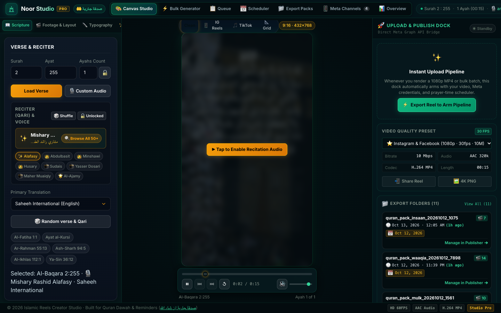
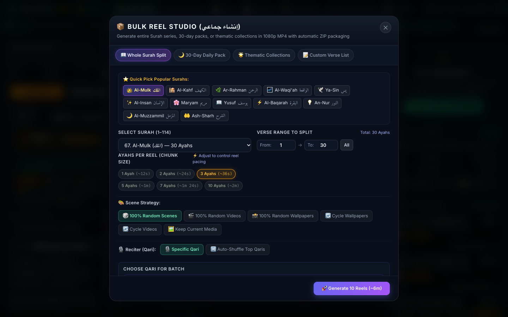
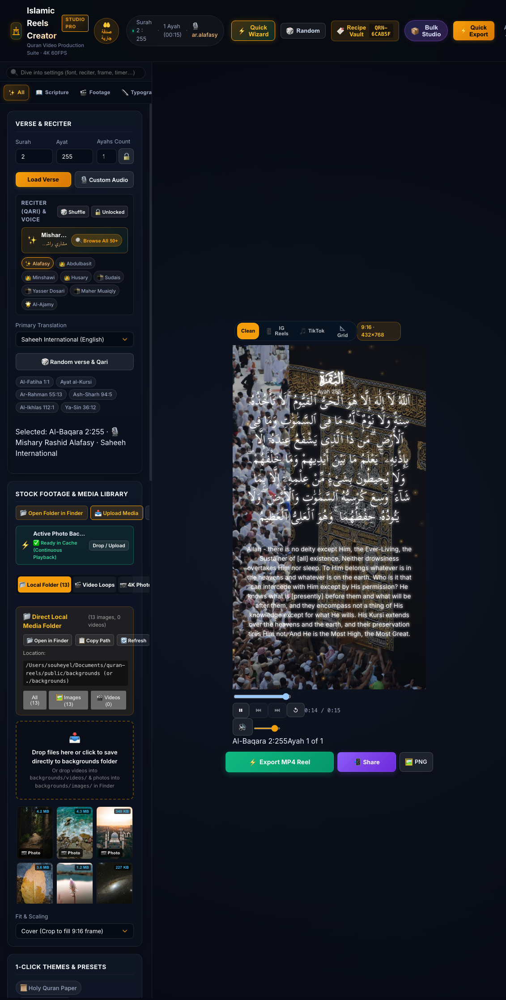
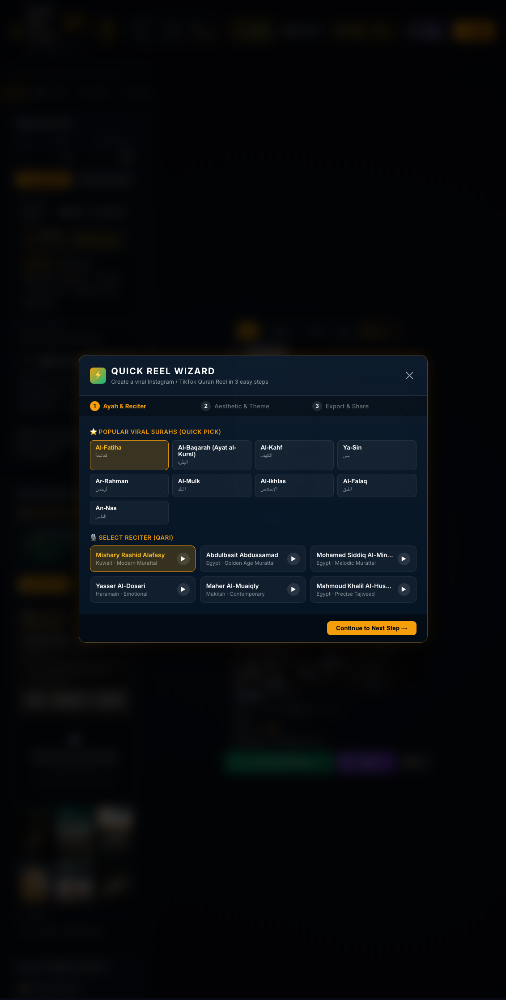

# Islamic Reels Creator & Bulk Publisher Studio 🎬📖✨

> **بِسْمِ ٱللَّهِ ٱلرَّحْمَٰنِ ٱلرَّحِيمِ**  
> ﴿ وَذَكِّرْ فَإِنَّ الذِّكْرَىٰ تَنفَعُ الْمُؤْمِنِينَ ﴾  
> *“And remind, for indeed, the reminder benefits the believers.”* — Surah Adh-Dhariyat (51:55)

---

## 🤲 App Bio & Dedication — Sadaqah Jariyah (صدقة جارية إن شاء الله)

> **قال رسول الله ﷺ:**  
> **«إِذَا مَاتَ ابْنُ آدَمَ انْقَطَعَ عَمَلُهُ إِلَّا مِنْ ثَلَاثٍ: صَدَقَةٍ جَارِيَةٍ، أَوْ عِلْمٍ يُنْتَفَعُ بِهِ، أَوْ وَلَدٍ صَالِحٍ يَدْعُو لَهُ»**  
> *(صحيح مسلم)*
>
> *The Messenger of Allah ﷺ said: “When a human being dies, their deeds come to an end except for three: an ongoing charity (Sadaqah Jariyah), beneficial knowledge, or a righteous child who prays for them.”* — (Sahih Muslim 1631)

**Islamic Reels Creator & Bulk Publisher** is built purely for the sake of Allah ﷻ as an ongoing charity (**Sadaqah Jariyah**). It is a unified, all-in-one production workstation and social distribution pipeline designed to empower Muslims, content creators, and organizations worldwide to produce breathtaking, studio-grade Quran video reels for **Instagram Reels, Facebook Reels, TikTok, YouTube Shorts, and WhatsApp Status** with ease, reverence, and automated multi-channel scheduling.

May Allah accept this humble endeavor from everyone who recites, builds, designs, creates, and shares these sacred verses.

---

## 📸 Visual Showcase

<div align="center">
  
  <p><em>Unified Studio Workspace: Live Canvas Preview, Word-by-Word Sub-Ayah Karaoke Glow, Real-Time Audio Spectrogram, and Studio Inspector</em></p>
</div>

<br/>

| Bulk Generator & Master Manifest | Direct Local Backgrounds & Media Library |
| :---: | :---: |
|  |  |
| *Automated batch creation with master manifest.json* | *1-click Finder opening, drag-and-drop disk save & live scanning* |

<br/>

<div align="center">
  
  <p><em>3-Step Quick Reel Wizard: Viral Surahs, Master Reciter Selection, and Instant Export</em></p>
</div>

---

## 🌟 Major Suite Upgrade — What's New

### 🚀 1. Complete All-in-One Studio Integration
The entire creation, batch processing, and multi-channel publishing ecosystem is now consolidated into a single unified application with matching celestial dark aesthetics (`#051424`, obsidian glass, gold accents):
* **🎨 Canvas Studio**: Real-time rendering engine with sub-pixel typography, 25+ classical and contemporary Qaris, audio spectrogram visualizers, particles, and 1080p 60FPS video export.
* **⚡ Bulk Generator**: Rapid chunking of entire Surahs or thematic packs into 1–10 Ayah reel series with master `manifest.json` indexing.
* **📋 Reel Queue Library**: Production review grid with batch-level filtering, caption editing, hashtag management, and status tracking (`READY`, `SCHEDULED`, `PUBLISHED`, `FAILED`).
* **📅 Accurate Publishing Calendar**: Interactive calendar view with day/week/month matrix, local timezone preservation, and solar prayer time scheduling.
* **📁 Export Packs Explorer**: Instant disk scanning of `./exports/` folder showing updated timestamps, video counts, and manifest availability.
* **📱 Meta Channels Hub**: Facebook Pages and linked Instagram accounts management, follower statistics, and token health monitors.
* **📊 Production Nerd Stats**: Live diagnostics monitor for video resolution, frame rate (60 FPS), duration standards, and audio LUFS normalization.

---

### 🕌 2. Accurate Publishing Calendar with Solar Prayer Pacing
* **Astronomical Solar Prayer Alignment**: Pre-schedule Quran video drops aligned with authentic prayer times:
  - 🌅 **Fajr** (Dawn til Sunrise)
  - ☀️ **Dhuhr** (Midday Sun)
  - 🌤️ **Asr** (Afternoon)
  - 🌇 **Maghrib** (Sunset)
  - 🌌 **Isha** (Night)
  - 🌙 **Tahajjud** (Last Third of the Night)
* **Local Timezone Preservation**: Eliminates UTC time drift bugs. The schedule calculator uses local clock time (`YYYY-MM-DD` and `HH:mm`) to ensure each post publishes at your exact target local hour.
* **Custom Pacing Sequences**: Choose between Solar Prayer intervals, fixed pacing (e.g. every 3 hours), or daily drops (1 reel per 24 hours).

---

### ☁️ 3. Meta Cloud Pre-Scheduling (Zero-Laptop Dependency)
* **Direct Cloud Ingestion**: Streams video files directly to Meta Graph API data centers using official 3-step Resumable Video Upload sessions.
* **Turn Off Your Computer**: By submitting videos with a future `scheduled_publish_time` timestamp (between 10 minutes and 75 days in advance), Meta holds and automatically publishes your Reels on Facebook and Instagram at the designated time—**no local machine, background tab, or daemon needs to stay awake**.
* **Automatic Instagram Relay**: For connected Instagram Business accounts (`@username`), the studio worker coordinates publishing triggers seamlessly.

---

### 🛡️ 4. Batch Isolation & Anti-Duplicate Queue Engine
* **Strict Scope Isolation**: When sending newly generated bulks into the scheduler, the system automatically isolates the target scope:
  - **`🎯 Latest Batch`**: Targets strictly the reels from your most recent generation (`latestBatchName`), preventing old generations from being bundled in.
  - **`✨ Selected in Queue`**: Targets only the reels you manually selected in the Queue library.
  - **`📋 All Ready`**: Explicit opt-in mode if you intentionally want to schedule your historical backlog.
* **Interactive Checklist with Batch Badges**: Inspect every targeted reel before confirming. Reels are labeled with <span style="color:#34d399">`LATEST BATCH`</span> or `OLD BATCH` tags with individual toggle checkboxes.
* **Deterministic ID & Hash Deduplication**: Reels are assigned deterministic identifiers (`bulk-${packFolderName}-${idx}`) and deduplicated by filename and batch hash upon ingestion, preventing duplicate cards when re-saving or re-exporting.
* **1-Click Queue Clean-Up**:
  - `🧹 Clear Unscheduled`: Clears unscheduled and failed draft reels while preserving already scheduled drops.
  - `✅ Clear Published`: Purges completed historical posts.
  - `⚠️ Clear All`: Full queue reset.

---

### 📁 5. Format 1 Master `manifest.json` Support & Export Explorer
The studio creates and reads standardized master manifest files for seamless archiving and third-party automation:
* **Dual Format Parser**: Reads both **Format 1 (Array `[ ... ]`)** and **Key-Value Dictionary (`{ ... }`)** manifest structures.
* **Rich Metadata Tagging**: Preserves Surah number, English & Arabic names, Ayah ranges, Qari reciters, authentic tafsir virtues, and context hashtags.
* **Human-Friendly Date Tracking**: The Export Packs explorer highlights folder modification times, relative time ago (e.g., *"15 mins ago"*), and formatted dates.

```text
exports/quran_pack_kahf_20261013_1200/
├── manifest.json
├── 01_al_kahf_verses_1_10.mp4
├── 02_al_kahf_verses_11_20.mp4
└── 03_al_kahf_verses_21_31.mp4
```

---

### 🎛️ 6. Video Player & Canvas Studio Overhaul
* **Aspect Ratio & Scale Optimization**: Removed accidental zoom and clipping from the canvas preview. Controls and video frames maintain strict 9:16 vertical proportion on all viewport dimensions.
* **Interactive Audio & Scrubbing Controls**: Synchronized playhead scrubber, audio mute toggles, duration countdowns, and real-time canvas resizing.
* **Offline Audio Normalization**: Automatic compliance checks targeting social standard **-14.0 LUFS** with integrated loudness headroom analysis.

---

### 🐍 7. Unified Python CLI Toolkit (`scripts/bulk_uploader.py`)
For power users and server automation, the included Python CLI tool offers head-less manifest ingestion and resumable Meta Cloud uploads:

```bash
# Display help and available options
python3 scripts/bulk_uploader.py --help

# Dry-run validation (checks video files, sizes, captions without uploading)
python3 scripts/bulk_uploader.py --dry-run

# Pre-schedule export folder across daily Islamic prayer times
python3 scripts/bulk_uploader.py --folder "exports/quran_pack_kahf_20261013_1200" --prayer-times

# Pre-schedule drops at 3-hour intervals
python3 scripts/bulk_uploader.py --folder "exports/quran_pack_kahf_20261013_1200" --interval 180

# Publish immediately
python3 scripts/bulk_uploader.py --folder "exports/quran_pack_kahf_20261013_1200" --publish-now
```

---

## 🌟 Core Creation Capabilities

### 🎙️ 25+ Classical & Contemporary Master Reciters (Qaris)
Audio fetched on-demand from the EveryAyah high-bitrate CDN:
* **Golden Age Masters**: Mahmoud Khalil Al-Husary, Abdulbasit Abdussamad, Mohamed Siddiq Al-Minshawi, Mustafa Ismail, Mohammad Mahmoud Al-Tablawi, Mahmoud Ali Al-Banna, Ali Jaber, Muhammad Ayyub, Ali Al-Hudhaify.
* **Contemporary Imams**: Mishary Rashid Alafasy, Abdulrahman Al-Sudais, Saud Al-Shuraim, Yasser Al-Dossari, Maher Al-Muaiqly, Nasser Al-Qatami, Abu Bakr Al-Shatri, Saad Al-Ghamdi, Fares Abbad, Hani Ar-Rifai.

### ✨ Ultra-Smooth Continuous Karaoke Glow
* Continuous Hermite-cosine light transitions illuminating Arabic calligraphy word-by-word with blooming golden radiance (`#ffd700` or custom tint).

### 🎨 Authentic Islamic Arabesque Frames & Gilded Borders
* Gilded Ottoman floral arabesques, Andalusian geometric double frames, Moorish royal horseshoe arches, and smooth radial cinematic vignettes.

### 🌊 Voice Waveform & Spectrum Visualizers
* Real-time audio spectrum bars, fluid bezier sine waves, vocal pulse lines, and harmonic particle grids rendered in hardware-accelerated 60 FPS.

### 🎥 7 Cinematic Camera Motion Presets (Ken Burns)
* Slow push-in, expansive reveal, horizontal pan, ascending tilt, diagonal glide, contemplative breathing pulse, and static framing.

### 📱 Native Android App (Official APK Release)
* **Direct Download**: 📥 **[Download Quran Reels Creator APK v1.0.0 (7.48 MB)](https://github.com/souheyell/quran-reels/releases/download/v1.0.0/quran-reels-creator.apk)**
* Standalone installable Android APK powered by Capacitor with GPU hardware acceleration, WebCodecs 60FPS video rendering, and native Android Share sheet integration.

---

## 🛠️ Technology Stack
* **Frontend**: React 19, TypeScript, Vite 8, Tailwind CSS v4, Vanilla CSS Design Tokens
* **Video & Audio Pipeline**: WebCodecs API, MediaRecorder API, MP4-Muxer, Web Audio API (AnalyserNode)
* **Rendering Engine**: HTML5 Canvas 2D with sub-pixel interpolation and offscreen backpressure streaming
* **Mobile Runtime**: Capacitor 8 (Android SDK)
* **Cloud Bridge Daemon**: Node.js HTTP Streaming Server (port 3001)
* **CLI Engine**: Python 3 (urllib, pathlib, json)
* **Quality & Testing**: Vitest 4 (22 test suites, 131 automated unit tests), Oxlint, TypeScript Compiler

---

## 🚀 Getting Started

### Prerequisites
* **Node.js**: v18.0.0 or higher
* **npm** or **pnpm**
* **Python 3**: (optional, for running `scripts/bulk_uploader.py`)

### Installation
```bash
git clone https://github.com/souheyell/quran-reels.git
cd quran-reels
npm install
```

### Environment Configuration (Optional)
To connect your own Facebook Pages or configure default tokens without committing them to git:
1. Copy the environment template:
   ```bash
   cp .env.example .env
   ```
2. Open `.env` and fill in your Meta credentials:
   ```env
   VITE_META_APP_ID=your_meta_app_id
   VITE_META_USER_ACCESS_TOKEN=your_user_access_token
   VITE_FB_PAGE_ACCESS_TOKEN=your_page_access_token
   ```

### 1-Click Launch (Unified Studio + Cloud Bridge)
Launch the unified web application, start the Cloud Bridge daemon, and open your browser automatically:
```bash
./start.sh
# or
npm start
```
* **Unified Studio**: [http://localhost:5173/](http://localhost:5173/)
* **Cloud Bridge**: [http://localhost:3001/](http://localhost:3001/)

To cleanly shut down all running background services:
```bash
./shutdown.sh
# or
npm stop
```

### Development Server Only
```bash
npm run dev
```

### Automated Testing & Type Checking
```bash
# Run Vitest test suites (131 tests)
npm test

# Run strict TypeScript compiler validation
npm run typecheck

# Build optimized production bundle
npm run build
```

---

## 🔒 Security & Privacy Practices
* **Zero Hardcoded Secrets**: No sensitive access tokens, private keys, or passwords are baked into source code or repository commits.
* **Environment Separation**: All credentials rely on local environment variables (`.env`, `.env.local`), which are strictly ignored in `.gitignore`.
* **Local-First Processing**: Video rendering, audio mixing, and manifest generation occur 100% locally inside your browser or device without transmitting media to third-party proprietary servers.
* **Cloud Safety**: Direct Meta Graph API requests are routed strictly to official Meta endpoints (`graph.facebook.com/v20.0`) with OAuth 2.0 authorization headers.

---

## 📄 License & Dedication
Open-source under the [MIT License](LICENSE). Built for Quran Dawah, spiritual reflection, and education as a **Sadaqah Jariyah (صدقة جارية إن شاء الله)**.
